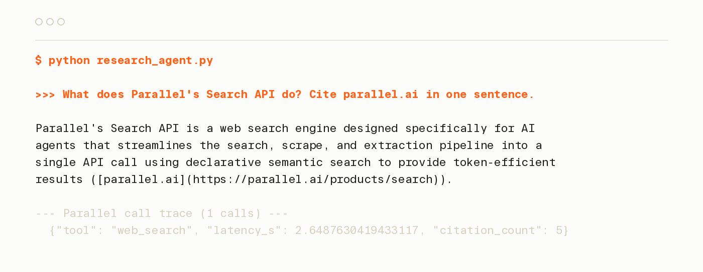

<p align="center">
  
</p>

# parallel-google-adk

[](https://pypi.org/project/parallel-google-adk/)
[](https://pypi.org/project/parallel-google-adk/)
[](LICENSE)

Google [Agent Development Kit](https://adk.dev) (ADK) tools and plugin for [Parallel](https://parallel.ai) — grounded web search, clean extraction, and cited deep research with structured output.

## Install

```bash
pip install parallel-google-adk
export PARALLEL_API_KEY=your-key-here  # get one at https://platform.parallel.ai
```

## Quickstart

```python
import os
from google.adk.agents import LlmAgent
from google.adk.runners import Runner

from parallel_google_adk import (
    web_search, web_fetch, extract,
    deep_research, enrich,
    ParallelTracingPlugin,
)

agent = LlmAgent(
    model="gemini-flash-latest",
    name="research_agent",
    instruction=(
        "You are a research assistant. Use web_search to find sources, "
        "web_fetch or extract for specific URLs, and deep_research for "
        "comprehensive cited reports."
    ),
    tools=[web_search, web_fetch, extract, deep_research, enrich],
)

# Plugins attach to the Runner, not the agent.
runner = Runner(agent=agent, app_name="my-app", plugins=[ParallelTracingPlugin()])
```

## Tools

| Tool | What it does |
|---|---|
| `web_search` | Grounded web search returning citation-aware excerpts. |
| `web_fetch` | Clean content from a single URL. Handles JS and PDFs. |
| `extract` | Batch extraction across 1–20 URLs with optional objective. |
| `deep_research` | Multi-hop investigation with per-claim citations. Returns a markdown report. |
| `enrich` | Structured (JSON-Schema-conforming) enrichment of a list of entities. |

## Plugin

`ParallelTracingPlugin` records latency, citation count, and (when reported) cost for every Parallel tool call. Read the trace from `tool_context.state["_parallel_calls"]`.

## MCP alternative

If you only want Search and don't want a Python dependency, the [Parallel Search MCP](https://docs.parallel.ai/integrations/mcp/search-mcp) works with ADK's `MCPToolset`:

```python
import os
from google.adk.tools.mcp_tool.mcp_toolset import MCPToolset
from google.adk.tools.mcp_tool.mcp_session_manager import StreamableHTTPConnectionParams

MCPToolset(
    connection_params=StreamableHTTPConnectionParams(
        url="https://search.parallel.ai/mcp",
        headers={"Authorization": f"Bearer {os.environ['PARALLEL_API_KEY']}"},
    ),
)
```

This package is the typed-FunctionTool path for users who want fine-grained schemas, hidden polling, structured enrichment, and tracing.

## Examples

See [`examples/research_agent.py`](examples/research_agent.py) for a runnable demo. A run looks like this:



## Development

```bash
pip install -e ".[dev]"
pytest                              # unit tests (no network)
pytest tests/integration/           # live API smoke (needs PARALLEL_API_KEY + GOOGLE_API_KEY)
```

## License

MIT
